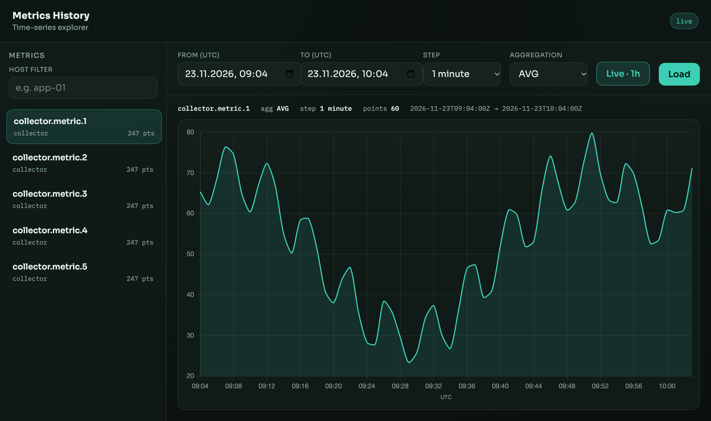
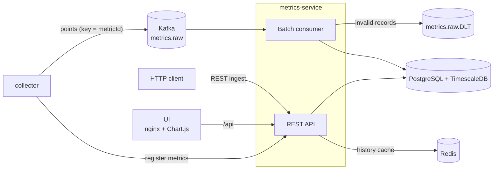

# Metrics History

[](https://github.com/midi-redenius/metrics-history/actions/workflows/ci.yml)

A small time-series service: ingest metric points over HTTP or Kafka, store them in PostgreSQL + TimescaleDB, and serve aggregated history for charts.



**Stack:** Java 21, Spring Boot 4.2 (Spring Framework 7, Jackson 3), Spring Kafka 4, Kafka 4.4, Spring Data JPA, PostgreSQL 17 + TimescaleDB, Redis, Flyway, Testcontainers, Docker Compose, GitHub Actions. Frontend: Vite + TypeScript + Chart.js.

## Quick start

Requires Docker only.

```bash
docker compose up -d --build
```

| What | URL |
|------|-----|
| UI | http://localhost:3000 |
| Swagger UI | http://localhost:8080/swagger-ui.html |
| Health / Prometheus | http://localhost:8080/actuator/health, `/actuator/prometheus` |

The `collector` starts writing five synthetic metrics every 5 s, so the chart fills up within a minute. Host ports can be changed through `.env` (see `.env.example`).

## Architecture



| Module | Role |
|--------|------|
| `metrics-common` | Kafka message DTO shared by producer and consumer |
| `metrics-service` | REST API, Kafka consumer, history queries, cache |
| `collector` | registers metrics and publishes synthetic points to Kafka |
| `frontend` | metric list and chart with a live mode |

## Design decisions

**TimescaleDB for points.** `metric_point` is a hypertable with daily chunks. Chunks older than 7 days are compressed, segmented by `metric_id` so a query for one metric reads only its own segments. Chunks older than the retention period (90 days by default, `POINT_RETENTION`) are dropped whole, which is instant and leaves no bloat, unlike `DELETE`. Continuous aggregates were left out on purpose: at this data volume raw queries are fast, and percentiles cannot be rolled up correctly from hourly buckets.

**Aggregation in SQL.** History is one query: `date_bin` buckets plus `AVG` / `MIN` / `MAX` / `PERCENTILE_CONT(0.95)`. The database returns at most a few thousand rows instead of every raw point, and a single request is capped at 10 000 buckets.

**Idempotent ingest.** Points have a natural key `(metric_id, ts)` and are written with `INSERT … ON CONFLICT DO UPDATE`, so redelivered Kafka messages and retried HTTP requests are harmless (last write wins).

**Batch Kafka consumer.** One poll means one metric-existence query and one batched upsert (`reWriteBatchedInserts`). Records are keyed by `metricId`, so points of one metric stay ordered within a partition.

**Dead letter topic instead of a stuck partition.** Malformed JSON, invalid messages and unknown metrics go to `metrics.raw.DLT` immediately, with the original bytes and `kafka_dlt-*` headers. Other errors are retried twice first. When a record in the middle of a batch fails, the valid records before it are committed and only the bad one is sent to the DLT.

**Cache invalidation via generations.** History responses are cached in Redis. The key includes a per-metric generation counter that is incremented after an ingest transaction commits, so invalidation is a single `INCR` instead of scanning keys, and stale entries simply expire. The TTL depends on the step: 30 s for fine steps, up to 15 min for hourly and coarser ones.

**Readiness without Kafka.** The readiness probe checks the database and Redis only. If Kafka is down, the HTTP API keeps serving and the consumer catches up later; Kafka health is still visible in `/actuator/health`.

**Tests against real infrastructure.** Integration tests run on Testcontainers with the same TimescaleDB, Kafka and Redis images as Compose, covering upsert semantics, the DLT paths, cache invalidation and retention.

## API

| Method | Path | Purpose |
|--------|------|---------|
| `POST` | `/api/v1/metrics` | register a metric |
| `GET` | `/api/v1/metrics/{id}` | get a metric |
| `GET` | `/api/v1/metrics?host=…&name=…` | list with optional filters, paginated (max 100 per page) |
| `POST` | `/api/v1/metrics/{id}/points` | ingest one point (`204`) |
| `POST` | `/api/v1/metrics/{id}/points/batch` | ingest up to 1000 points |
| `GET` | `/api/v1/metrics/{id}/history` | aggregated history |

History parameters: `from`, `to` (ISO-8601), `step` (`1 minute`, `15 minutes`, `1 hour`, …), `agg` (`AVG`, `MIN`, `MAX`, `P95`).

```bash
curl -X POST localhost:8080/api/v1/metrics \
  -H 'Content-Type: application/json' \
  -d '{"name": "cpu.usage", "unit": "%", "host": "web-01"}'

curl 'localhost:8080/api/v1/metrics/1/history?from=2026-01-01T10:00:00Z&to=2026-01-01T11:00:00Z&step=5%20minutes&agg=P95'
```

Points can also be published to the `metrics.raw` topic, keyed by metric id:

```json
{ "metricId": 1, "ts": "2026-01-01T10:00:00Z", "value": 72.5 }
```

## Development

Run the infrastructure in Docker and the service from the IDE or Maven:

```bash
docker compose up -d postgres kafka redis
./mvnw spring-boot:run -pl metrics-service -Dspring-boot.run.profiles=local
```

UI dev server with hot reload (proxies `/api` to `localhost:8080`, override with `API_PROXY_TARGET`):

```bash
cd frontend && npm install && npm run dev   # http://localhost:5173
```

Tests (Docker must be running for Testcontainers):

```bash
./mvnw verify
```

JaCoCo writes a coverage report per module to `*/target/site/jacoco/index.html`; CI shows the summary on the run page.

The UI starts in live mode: the last hour, aligned to the step and refreshed every 10 s while the tab is visible. Dates and the chart axis are in UTC.
